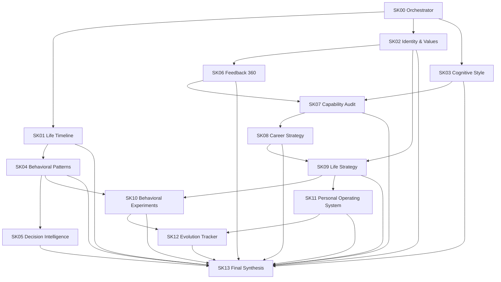

# Skill Dependency Graph

Dependencies are recommendations, not mandatory blockers. A skill may run independently with reduced scope when upstream data is absent. The report must disclose missing inputs rather than fabricate them.
